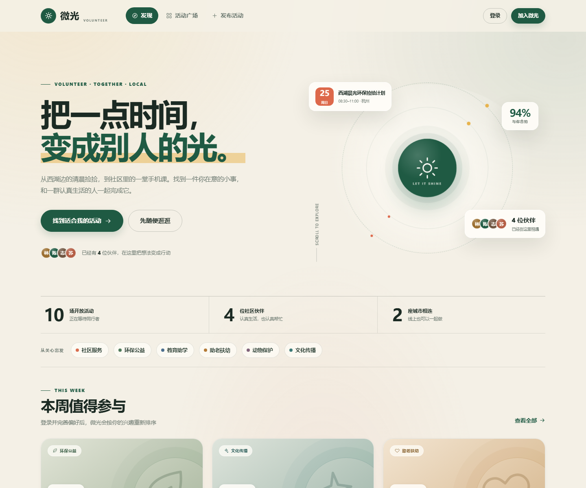

# 微光 · 本地志愿活动平台

一个完全在本机运行的中文志愿活动 Web 应用。用户可以注册多个账号、按兴趣获得活动推荐、浏览和筛选活动、报名或取消报名，也可以发起自己的志愿活动并管理报名名单。

前端是零依赖的原生 HTML / CSS / JavaScript，后端使用 Python 标准库 + SQLite。无需安装任何第三方包，也不需要联网。



## 快速开始

双击工作区里的 **`start-app.bat`**，浏览器会自动打开：

```
http://127.0.0.1:8000
```

也可以在当前目录运行：

```powershell
.\start-app.ps1
```

或者直接指定 Python：

```powershell
& "$env:USERPROFILE\.dsh\dsh-runtimes\dsh-next-primary-runtime\dependencies\python\python.exe" app.py --open
```

> 如果 8000 端口被占用，可改用其他端口：
>
> ```powershell
> $env:VOLUNTEER_PORT = "8010"; .\start-app.ps1
> ```

### 演示账号

| 账号 | 密码 | 昵称 | 城市 |
| --- | --- | --- | --- |
| `demo` | `demo1234` | 志愿小暖 | 杭州 |
| `lin` | `demo1234` | 林晓 | 杭州 |
| `chen` | `demo1234` | 陈默 | 上海 |
| `yue` | `demo1234` | 苏月 | 杭州 |

首次启动会自动生成 12 个演示账号、10 场未来活动和 20 条报名记录。所有演示账号的密码都是 `demo1234`。

## 已实现功能

### 账号与本地数据
- 注册、登录、退出登录，账号之间数据隔离
- 密码使用 PBKDF2-HMAC-SHA256（22 万次迭代）+ 随机盐存储，不保存明文
- 7 天有效的随机会话令牌，`HttpOnly` + `SameSite=Lax` Cookie
- SQLite 持久化，数据只写入本机 `data/volunteer.db`

### 个性化推荐
- 根据兴趣类别、活动标签、常驻城市、空闲时间、历史参与方向综合评分
- 每条推荐给出 60–99 的匹配度和最多 3 条推荐理由
- 自动排除自己发起的、已经报名的、已截止和已结束的活动
- 未登录时展示按热度与时间排序的公开活动
- 保存偏好后，首页推荐立即刷新

### 活动广场
- 关键词搜索（标题、介绍、地点、类别、标签、发起人）
- 按类别、城市、时间（本周末 / 7 天内 / 线上）筛选
- 响应式卡片、剩余名额、报名进度、发起人信息
- 空状态与加载骨架屏

### 发起与报名
- 发布活动：名称、类别、标签、介绍、城市、地点、起止时间、人数、联系方式
- 服务端完整校验（时间、长度、人数、过去时间等）
- 报名时可选填留言；可取消报名，名额自动恢复
- 发起人可以停止报名、重新开放、取消活动
- 发起人可查看报名名单和留言；普通参与者无权查看完整名单
- 联系方式只对发起人和已报名者可见
- 发起人不能报名自己的活动，满员后无法继续报名

### 个人中心
- 我报名的 / 我发起的活动
- 统计报名数、发起数、累计志愿时长
- 编辑昵称、城市、个人介绍、兴趣标签、空闲时段
- 修改偏好后，推荐结果同步更新

## 界面设计

- 暖纸色背景 + 森林绿主色 + 珊瑚橙点缀，强调“温和但可靠”的志愿氛围
- 大字号编辑部式标题、活动封面使用 CSS 抽象图形，不依赖外部图片
- 完全离线：无 CDN、无外部字体、无追踪脚本
- 响应式：桌面三列卡片、平板两列、手机单列 + 底部导航
- 支持键盘焦点、Esc 关闭弹窗、焦点圈定和 `prefers-reduced-motion`

## 项目结构

```
.
├── app.py                 # HTTP 服务、REST API、静态资源托管
├── db.py                  # SQLite schema、密码哈希、演示数据
├── static/
│   ├── index.html         # 单页应用外壳 + SVG 图标库
│   ├── styles.css         # 完整视觉系统与响应式布局
│   ├── app.js             # 路由、渲染、表单、弹窗、交互
│   └── favicon.svg
├── tests/
│   └── smoke_test.py      # 54 项端到端接口检查（使用独立临时数据库）
├── data/
│   └── volunteer.db       # 首次启动自动生成，保存所有数据
├── start-app.bat
├── start-app.ps1
└── README.md
```

## 数据模型

| 表 | 作用 | 关键字段 |
| --- | --- | --- |
| `users` | 账号与偏好 | `username`、`password_hash`、`salt`、`city`、`interests`、`availability` |
| `sessions` | 登录会话 | `token`、`user_id`、`expires_at` |
| `activities` | 志愿活动 | `creator_id`、`title`、`category`、`start_at`、`capacity`、`status` |
| `registrations` | 报名记录 | `activity_id`、`user_id`、`message`，`(activity_id, user_id)` 唯一 |

活动状态：

- `open`：报名中，会出现在广场和推荐里
- `closed`：已停止报名，不再出现在广场，但详情仍可访问
- `cancelled`：已取消，从广场移除，详情标记为已取消

## 推荐算法

对每位登录用户，服务端会给每场未结束的活动打分：

| 因素 | 加分 |
| --- | --- |
| 活动类别命中兴趣 | +20 |
| 活动标签命中兴趣 | 每个 +6，最多 +12 |
| 活动城市与常驻城市一致 | +13 |
| 线上活动 | +9 |
| 空闲时段与活动时间重叠（工作日/周末、上午/下午/晚上） | +8 |
| 历史上参与过同类活动 | +4 |
| 名额充足 / 已有热度 | +3 / +2 |
| 城市不一致 | −5 |

基础分为 58，最终限制在 60–99。排序后返回匹配度和可解释的推荐理由，而不是只给一个黑盒结果。

## API 一览

| 方法 | 路径 | 说明 |
| --- | --- | --- |
| `GET` | `/api/health` | 健康检查 |
| `GET` | `/api/meta` | 类别、兴趣、城市、平台统计 |
| `POST` | `/api/auth/register` | 注册并建立会话 |
| `POST` | `/api/auth/login` | 登录 |
| `POST` | `/api/auth/logout` | 退出 |
| `GET` | `/api/auth/me` | 当前登录用户 |
| `PUT` | `/api/profile` | 保存昵称、城市、兴趣、空闲时间 |
| `GET` | `/api/activities` | 搜索 / 筛选活动 |
| `POST` | `/api/activities` | 发布活动 |
| `GET` | `/api/activities/{id}` | 活动详情 |
| `PATCH` | `/api/activities/{id}` | 发起人修改报名状态 |
| `POST` | `/api/activities/{id}/registrations` | 报名 |
| `DELETE` | `/api/activities/{id}/registrations` | 取消报名 |
| `GET` | `/api/activities/{id}/participants` | 发起人查看报名名单 |
| `GET` | `/api/recommendations` | 个性化推荐 |
| `GET` | `/api/my/activities` | 我的报名 / 发起记录 |

所有写操作使用 JSON；接口不会把密码、密码哈希或会话令牌返回给前端。

## 运行测试

```powershell
& "$env:USERPROFILE\.dsh\dsh-runtimes\dsh-next-primary-runtime\dependencies\python\python.exe" tests\smoke_test.py
```

测试会启动独立服务、使用临时数据库，并在结束后清理。当前覆盖 54 项检查，包括：

- 注册、登录、会话、退出
- 偏好保存与推荐联动
- 发布活动、报名、重复报名、满员、取消报名
- 停止报名、重新开放、取消活动
- 发起人 / 普通用户的权限边界
- 联系方式可见性
- 参数校验、404 与静态资源

## 数据重置

如需清空所有账号、活动和报名，重新生成演示数据：

1. 停止服务（`Ctrl+C`）
2. 删除 `data/volunteer.db`
3. 重新启动

> 注意：这会删除所有本地数据，且不可恢复。

## 使用范围

本项目面向本机演示和个人使用，默认只监听 `127.0.0.1`。如果要部署到局域网或公网，需要额外补充 HTTPS、CSRF 防护、登录限流、备份与更严格的隐私策略，不建议直接把当前开发服务器暴露到公网。
